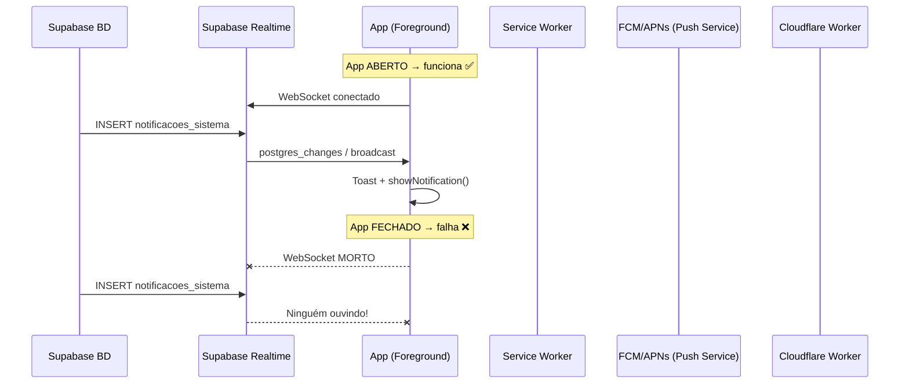
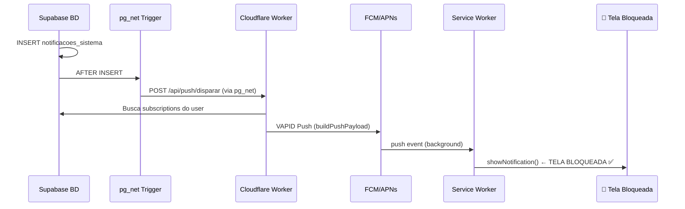

# 🔍 Análise de Causa Raiz — Push Notifications em Segundo Plano

## Diagnóstico: Por que as notificações SÓ chegam com o app aberto?

### Arquitetura Atual (Fluxo)



### 3 Bugs Críticos Identificados

#### Bug 1 — URL com duplo `?` impede consulta de assinaturas (CRÍTICO)

```javascript
// server.ts linha 1843 — BUGADO
const urlBusca = `${supabaseUrl}/rest/v1/user_push_subscriptions${filtroUrl}?select=...`;
// Quando filtroUrl = "?user_id=eq.xxx", gera:
// "...?user_id=eq.xxx?select=id,endpoint,p256dh,auth"  ← SEGUNDO ? INVALIDA A QUERY
```

**Efeito:** O PostgREST **nunca retorna** as assinaturas push do banco. Lista vazia = zero push enviado.

#### Bug 2 — Inscrição no servidor não persiste userId (CRÍTICO)

```javascript
// webPushService.ts linha 107 — NÃO envia userId
fetch("/api/push/inscrever", {
  body: JSON.stringify({
    subscription: sub.toJSON(),
    userAgent: navigator.userAgent,
    // userId: ??? ← FALTA!
  }),
});
```

**Efeito:** O endpoint `/api/push/inscrever` no servidor nunca grava `user_id` no banco, logo a busca filtrada por usuário retorna vazio.

#### Bug 3 — Nenhum mecanismo server-side dispara push automaticamente

O push SÓ é disparado quando o CLIENTE chama `fetch("/api/push/disparar")`. Se nenhum cliente está aberto, **nenhum push é enviado**. Falta um trigger no banco que dispare push automaticamente ao inserir notificação.

### Solução Implementada


